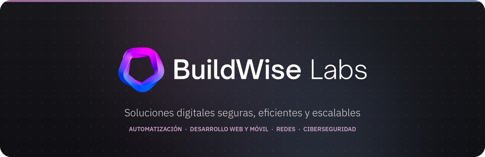

<div align="center">



[](https://buildwiselabs.net)
[](https://buildwiselabs.net/labs)
[](mailto:contacto@buildwiselabs.net)

</div>

---

## 👋 ¿Quiénes somos?

**BuildWise Labs** es un laboratorio de soluciones digitales hecho en México. Construimos tecnología de punta a punta: **automatización con IA, desarrollo web y móvil, infraestructura de redes y ciberseguridad**, para que las empresas operen más rápido, conectadas y protegidas.

> Convertimos procesos complejos en sistemas simples, seguros y escalables.

**Cómo trabajamos**

1. **Primero entendemos.** Antes de proponer herramientas vemos cómo trabaja tu equipo hoy, con qué archivos y en qué pasos se pierde el tiempo.
2. **Empezamos por lo que más duele.** Dejamos funcionando el proceso más urgente; lo demás se suma encima de algo que ya da resultado.
3. **Entregamos con capacitación y documentación.** Tu equipo puede operar y cambiar la solución sin depender de nosotros.

---

## 🧩 Servicios

| | Servicio | Qué resuelve |
|:-:|---|---|
| 🤖 | **[Chatbot Inteligente para PyMEs](https://buildwiselabs.net/servicios/chatbot)** | Asistente con IA que atiende por texto y voz, analiza archivos Excel y automatiza consultas. |
| ⚙️ | **[Automatización Inteligente](https://buildwiselabs.net/servicios/automatizacion)** | Conectamos tus herramientas y dejamos corriendo solos los procesos que hoy se hacen a mano. |
| 📱 | **[Desarrollo Web / Apps con IA](https://buildwiselabs.net/servicios/apps)** | Aplicaciones web y móviles inteligentes, listas para escalar y desplegar en la nube. |
| 🛡️ | **[Seguridad y Redes](https://buildwiselabs.net/servicios/redes)** | Servicios de red y evaluación de seguridad para mantener tu infraestructura protegida. |
| 🧭 | **[Consultoría y Estrategia](https://buildwiselabs.net/servicios/consultoria)** | Diagnóstico, implementación y capacitación para adoptar tecnología. |
| 📈 | **[Monitoreo Web](https://buildwiselabs.net/servicios/monitoreo)** | Vigilancia continua de tu sitio o aplicación, con alertas cuando algo falla. |
| 🏦 | **[Bank Central](https://buildwiselabs.net/servicios/bank-central)** | Tus sistemas conectados a los datos del banco central: tipo de cambio, inflación y tasas. |
| 🪙 | **[Cripto World](https://buildwiselabs.net/servicios/cripto-world)** | Precios en vivo, seguimiento de carteras y cobros en criptomonedas dentro de tu plataforma. |

---

## 📚 Labs: documentación

**[Labs](https://buildwiselabs.net/labs)** reúne la documentación técnica de lo que construimos: **42 guías** hechas con Docusaurus y publicadas dentro del mismo sitio.

| Sección | Contenido |
|---|---|
| **Primeros pasos** | Requisitos, instalación, cómo levantar un bot, configuración y primer mensaje |
| **Tools** | APIs disponibles, integraciones n8n, plugins de voz, procesamiento de Excel, webhooks |
| **Uso y operación** | Chat por texto y voz, reportes de campo, análisis de Excel, OpenWebUI, API, despliegue |
| **Soporte** | Preguntas frecuentes, solución de problemas, reportar un problema, tiempos de respuesta |
| **Aprende y comunidad** | Tutoriales, guía de prompts, ejemplos, glosario, casos de uso, hoja de ruta |
| **Compatibilidad** | Sistemas operativos, kernels, procesadores, GPU, RAM y requisitos de red |

---

## ✨ Novedades

- **Labs**: la documentación se integró al sitio, con menú lateral completo y enlace directo desde cada servicio.
- **Tres servicios nuevos**: Monitoreo Web, Bank Central y Cripto World.
- **Automatización** ahora es una página de venta: qué resolvemos, casos, proceso, paquetes y preguntas frecuentes.
- **Página Nosotros** y un **footer** nuevo con accesos rápidos, enlaces a todas las guías de Labs y la compatibilidad del chatbot.
- **Inicio renovado**: cinta de logos animada, sección de herramientas con las apps que usamos todos los días y portadas propias para cada servicio.
- **Modo claro y oscuro** en todo el sitio, y asistente flotante con su propia pantalla de carga.

---

## 🛠️ Stack tecnológico

<div align="center">

**Web y móvil**<br/>


**IA y automatización**<br/>


**Backend y datos**<br/>


**Infraestructura, redes y seguridad**<br/>


**Herramientas del día a día**<br/>


</div>

---

## 🗂️ Estructura del repositorio

| Carpeta | Qué contiene |
|---|---|
| [`expo/`](expo) | Sitio web de BuildWise Labs: Expo + React Native Web + NativeWind, con modo claro y oscuro. Incluye `labs-docs/` (Docusaurus), que se compila dentro del sitio. |
| [`backend/`](backend) | API en Node.js + Express: registro e inicio de sesión (JWT), formulario de contacto, servicios, likes y documentación por servicio en PostgreSQL. |
| [`chatbot/`](chatbot) | Chatbot PyME: chat por texto y voz, análisis de archivos Excel y respuestas con IA. Corre con Docker. |
| [`bot/`](bot) | Bot de reportes de campo: captura por WhatsApp (texto y audio), reportes en Excel y flujos de n8n; versión en Node.js para Hostinger. |
| [`GUI/`](GUI) | Visor de reportes de campo para escritorio (Python). |
| [`deploy/`](deploy) | Publicación del backend con Nginx o Caddy, HTTPS y DuckDNS (Linux y Windows/WSL). |
| [`docker/`](docker) | Configuración de escaneos de seguridad con OWASP ZAP. |
| [`md/`](md) | Notas técnicas: dominio, Vercel, Nginx, Cloudflare, Expo y más. |

---

## ⚡ Inicio rápido

**Sitio web**

```bash
cd expo
npm install
npx expo start --web        # http://localhost:8081
npm run labs:build          # compila Labs (Docusaurus) dentro del sitio
```

**API**

```bash
cd backend
cp .env.example .env        # pon tus propios valores; nunca subas el .env
npm install
npm run db:up && npm run db:seed   # PostgreSQL para la documentación (opcional)
npm run dev                         # http://localhost:3000
```

El sitio busca la API en `EXPO_PUBLIC_API_URL` (por defecto `http://localhost:3000`). Si vas a correr el chatbot al mismo tiempo, cambia el puerto de uno de los dos: ambos usan el 3000.

**Chatbot**

```bash
cd chatbot
cp .env.example .env
docker compose up -d --build
```

**Despliegue**

- **Sitio web** → Vercel (`expo/vercel.json`, compila con `expo export --platform web`). Define `EXPO_PUBLIC_API_URL` con la dirección pública de la API.
- **API** → servidor propio; los pasos están en [`deploy/`](deploy).
- **Bot de reportes** → Hostinger con PM2 y MySQL.

---

## 📊 Actividad en GitHub

<div align="center">


</div>

---

## 🔒 Seguridad

- Los secretos viven solo en archivos `.env` locales; en el repositorio van únicamente las plantillas `.env.example`.
- `.gitignore` excluye `.env`, `.mcp.json` y las credenciales de cuentas de servicio.
- ¿Encontraste una vulnerabilidad? Escríbenos a [contacto@buildwiselabs.net](mailto:contacto@buildwiselabs.net) en lugar de abrir un issue público.

---

## 📫 Contacto

<div align="center">

[](https://buildwiselabs.net)
[](https://www.linkedin.com/company/buildwiselabs)
[](https://instagram.com/buildwiselabs)
[](mailto:contacto@buildwiselabs.net)

</div>

---

<div align="center">

### *"Construimos sabiamente. Construimos seguro."*

© 2026 BuildWise Labs · Hecho en México 🇲🇽 · Todos los derechos reservados.

</div>
