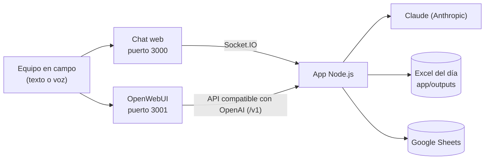

# Chatbot PYME

El Chatbot PYME es un asistente de inteligencia artificial pensado para la operación de campo. El equipo le escribe o le habla, desde el celular o la computadora, y el asistente contesta, guarda los datos de la jornada en Excel y en Google Sheets, y analiza archivos de combustible.

Esta documentación explica cómo instalarlo, configurarlo, usarlo y mantenerlo funcionando.

## Qué hace

- **Conversa por texto y por voz.** Las respuestas llegan en tiempo real mientras se escriben, y el asistente puede contestar en voz alta.
- **Registra reportes de campo.** Si un mensaje trae datos de la operación, como litros de diésel, una poda o un avance en hectáreas, el asistente los guarda solo en el Excel del día y en la pestaña que corresponde de Google Sheets. Nadie tiene que capturarlos.
- **Analiza archivos de Excel.** Subes un reporte de combustible y recibes el gasto total, los promedios por día y por semana y el desglose por unidad, más un Excel con el resultado listo para descargar.
- **Ofrece una interfaz completa con OpenWebUI.** Además del chat propio, el mismo asistente se puede usar desde OpenWebUI, que guarda conversaciones, maneja usuarios y funciona como una app de chat completa.

## Cómo está armado

| Pieza | Qué es | Dónde vive |
|---|---|---|
| **App** | Servidor Node.js con Express y Socket.IO. Atiende el chat web, la API y el análisis de archivos, y habla con Claude. | `app/` |
| **Chat web** | La interfaz propia: texto, voz y subida de archivos. | `app/public/` |
| **OpenWebUI** | Interfaz de chat completa, conectada a la app por la API `/v1`. | Contenedor `openwebui` |
| **Claude** | El modelo de lenguaje que responde y extrae los datos de los mensajes. | API de Anthropic |
| **Excel y Google Sheets** | Donde quedan los reportes de campo. | `app/outputs/` y tu hoja de cálculo |

:::note Sobre Ollama
El `docker-compose.yml` también levanta Ollama, que sirve para correr modelos de forma local. La versión actual de la app responde con Claude. Si quieres usar modelos locales, la página de [APIs disponibles](../tools/apis.md) muestra los proveedores que integramos.
:::

## Por dónde empezar

1. [Instalación](./instalacion.md): ponerlo a funcionar con Docker.
2. [Configuración](./configuracion.md): claves, modelo, instrucciones del asistente y palabras clave.
3. [Uso](./uso/chat.md): chatear, registrar reportes y analizar archivos.
