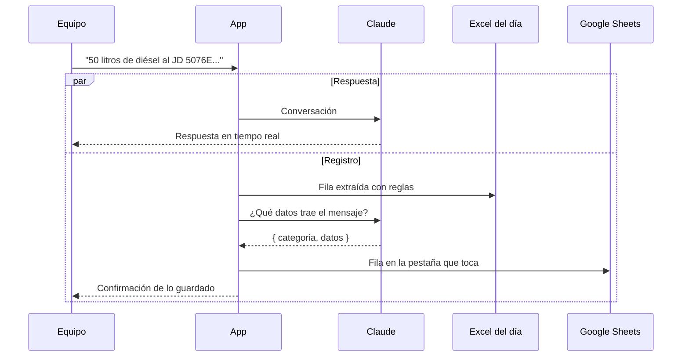

# Reportes de campo

La función central del asistente es convertir lo que el equipo cuenta en filas de un reporte, sin formularios.

## Cómo se registra un dato

Basta con escribirlo o decirlo con naturalidad:

> Cargamos 50 litros de diésel al JD 5076E para el desbarado en la huerta El Nogal, responsable Juan Pérez

> Poda en el bloque 3 con 12 personas, 340 árboles

> Aplicamos 20 kg de fertilizante en la huerta Las Palmas

Cuando el mensaje contiene alguna de las [palabras clave](../configuracion.md#palabras-clave-de-registro), pasan dos cosas en paralelo:

1. **Excel del día.** La app identifica la categoría y extrae los datos con reglas: actividad, huerta, responsable, equipo, implemento, litros, precio, hectáreas, personas, cantidades y combustible. Después los agrega al archivo `app/outputs/reporte_campo_AAAA-MM-DD.xlsx`. Si hay litros y precio por litro, también calcula el costo total.
2. **Google Sheets.** Claude lee el mensaje, decide la categoría y devuelve los campos completos. La fila se agrega a la pestaña correspondiente de la hoja, y en el chat aparece una confirmación con lo que se guardó.

## Categorías

| Categoría | Cuándo aplica | Ejemplos de palabras |
|---|---|---|
| **Maquinaria** | Combustible, equipos e implementos | diésel, litros, tractor, desvaradora |
| **Rendimiento** | Trabajo del personal y avance | poda, riego, cosecha, jornal, personas |
| **Insumos** | Materiales aplicados | fertilizante, herbicida, fungicida |
| **Resumen** | Totales de la semana | semana, resumen semanal |

Si se menciona una falla, una ausencia o la lluvia, el registro de rendimiento marca la **incidencia** y, cuando puede, guarda el motivo.

## Consultar los reportes

- **En el navegador:** la página `/reportes` de la app lista los archivos de Excel generados, con su fecha y su enlace de descarga.
- **Desde otra aplicación:** la [API](../referencia/api.md#reportes) devuelve la lista de archivos y el contenido de cada hoja en JSON. Así es como el Visor de reportes del sitio muestra los datos.
