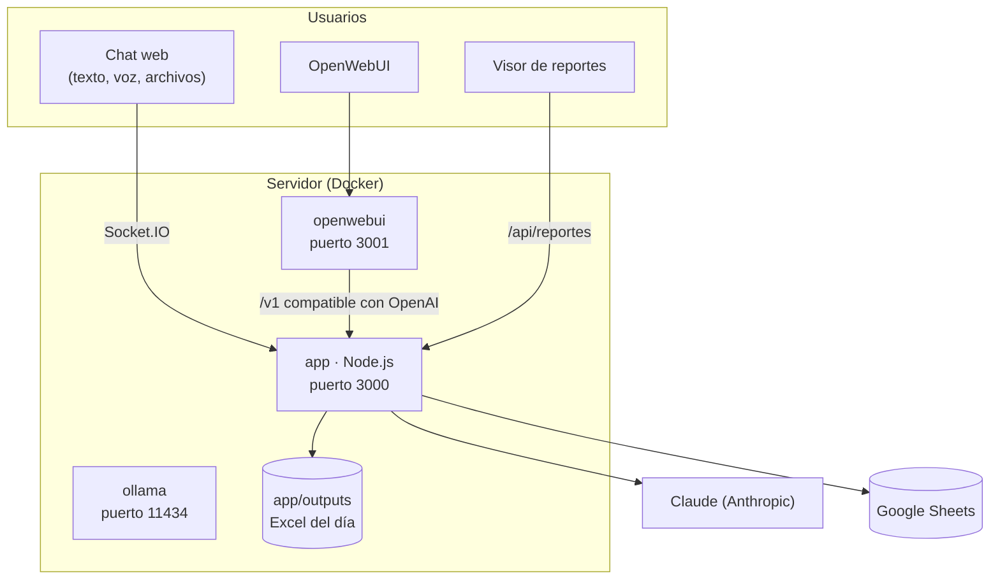

# Arquitectura del sistema

El Chatbot PYME son tres contenedores de Docker que se levantan juntos con `docker compose`.

## Componentes

| Componente | Imagen | Qué hace |
|---|---|---|
| **app** | `node:20-alpine` (se construye desde `app/`) | Servidor Express con Socket.IO. Sirve el chat web, la API de reportes, la carga de archivos y la API compatible con OpenAI. Habla con Claude. |
| **openwebui** | `ghcr.io/open-webui/open-webui` | Interfaz de chat completa. Usa la app como si fuera un proveedor de OpenAI. |
| **ollama** | `ollama/ollama` | Corre modelos de lenguaje en el propio servidor. Está disponible, pero la app responde con Claude. |

## Cómo viaja un mensaje

1. El mensaje llega por Socket.IO (chat web) o por `POST /v1/chat/completions` (OpenWebUI).
2. La app lo manda a Claude junto con las instrucciones del asistente (`getSystemPrompt()`) y el historial de la conversación.
3. La respuesta vuelve en fragmentos y se muestra mientras se escribe.
4. En paralelo, si el mensaje trae [palabras de la operación](../chatbot/configuracion.md#palabras-clave-de-registro), se registra en el Excel del día y en Google Sheets.

## Dónde quedan los datos

| Dato | Dónde | Cuánto dura |
|---|---|---|
| Conversación del chat web | Memoria de la app, por conexión | Hasta que se cierra o recarga la pestaña |
| Conversaciones de OpenWebUI | Volumen `open-webui` | Hasta que se borren en OpenWebUI |
| Reportes de campo | `app/outputs/reporte_campo_AAAA-MM-DD.xlsx` | Permanente (respáldalos) |
| Reportes en la nube | Google Sheets | Permanente, con historial de versiones |
| Archivos subidos para análisis | `app/uploads/` | Se borran al terminar el análisis |
| Resultados de análisis | `app/outputs/resultado_*.xlsx` | Permanente |

Los mensajes se envían a la API de Anthropic para generar las respuestas. Ver [Seguridad y privacidad](../orientaciones/seguridad.md).
