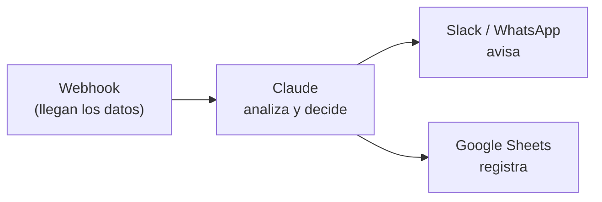

# Integraciones n8n

[n8n](https://n8n.io) es donde armamos los flujos automáticos: algo pasa (llega un correo, un webhook, una fila nueva), la IA decide qué hacer y el flujo actúa (avisa en Slack, guarda en Sheets, responde por WhatsApp).

## Un flujo típico



## Llamar a Claude desde n8n

Hay dos formas. La primera no necesita configurar nada en el servidor de n8n.

### Con el nodo HTTP Request

| Campo | Valor |
|---|---|
| Método | `POST` |
| URL | `https://api.anthropic.com/v1/messages` |
| Encabezados | `x-api-key`: tu llave · `anthropic-version`: `2023-06-01` · `content-type`: `application/json` |
| Cuerpo (JSON) | el de abajo |

```json
{
  "model": "claude-haiku-4-5-20251001",
  "max_tokens": 512,
  "system": "Analiza los datos de ventas y genera un resumen ejecutivo en 3 puntos.",
  "messages": [{ "role": "user", "content": "{{ JSON.stringify($json) }}" }]
}
```

La respuesta trae el texto en `content[0].text`; el siguiente nodo lo toma de ahí.

:::tip La llave en una credencial
Guarda la llave de Anthropic como credencial de tipo *Header Auth* en n8n y selecciónala en el nodo, en vez de escribirla en el encabezado. Así no queda a la vista en el flujo.
:::

### Con el nodo Code

```js
// Nodo "Code" de n8n (JavaScript)
const Anthropic = require('@anthropic-ai/sdk');
const client = new Anthropic({ apiKey: $env.ANTHROPIC_API_KEY });

// Los datos llegan del nodo anterior (webhook, Google Sheets, etc.)
const datos = $input.first().json;

const respuesta = await client.messages.create({
  model: 'claude-haiku-4-5-20251001',
  max_tokens: 512,
  system: 'Analiza los datos de ventas y genera un resumen ejecutivo en 3 puntos.',
  messages: [{ role: 'user', content: JSON.stringify(datos) }],
});

// Pasa el resumen al siguiente nodo (Slack, Gmail, etc.)
return [{ json: { resumen: respuesta.content[0].text } }];
```

:::warning Requisito en n8n autoalojado
El nodo Code solo puede usar librerías externas si el servidor de n8n lo permite. Instala `@anthropic-ai/sdk` en la instancia y define `NODE_FUNCTION_ALLOW_EXTERNAL=@anthropic-ai/sdk`. También necesita la variable `ANTHROPIC_API_KEY` en el entorno de n8n.
:::

## Buenas prácticas

- **Un flujo, un trabajo.** Es más fácil saber qué falló en tres flujos chicos que en uno enorme.
- **Revisión humana en lo delicado.** Si la IA va a mandar algo a un cliente o a cambiar un registro, agrega un paso de aprobación.
- **Avisos de error.** Configura un *Error Workflow* que avise por Slack o Discord cuando un flujo falla (ver [Webhooks](./webhooks.md)).
